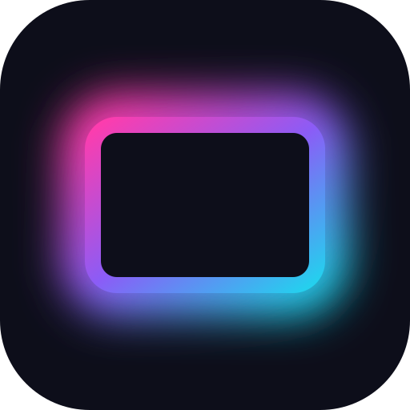
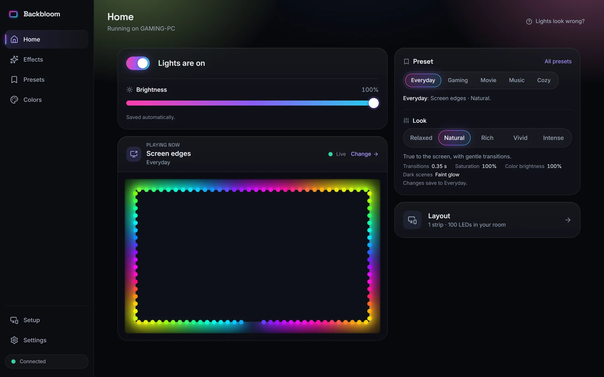
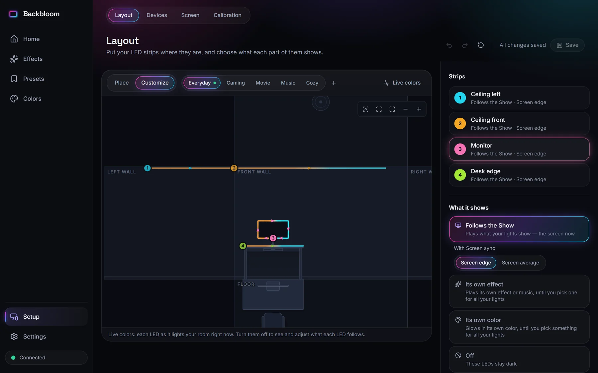
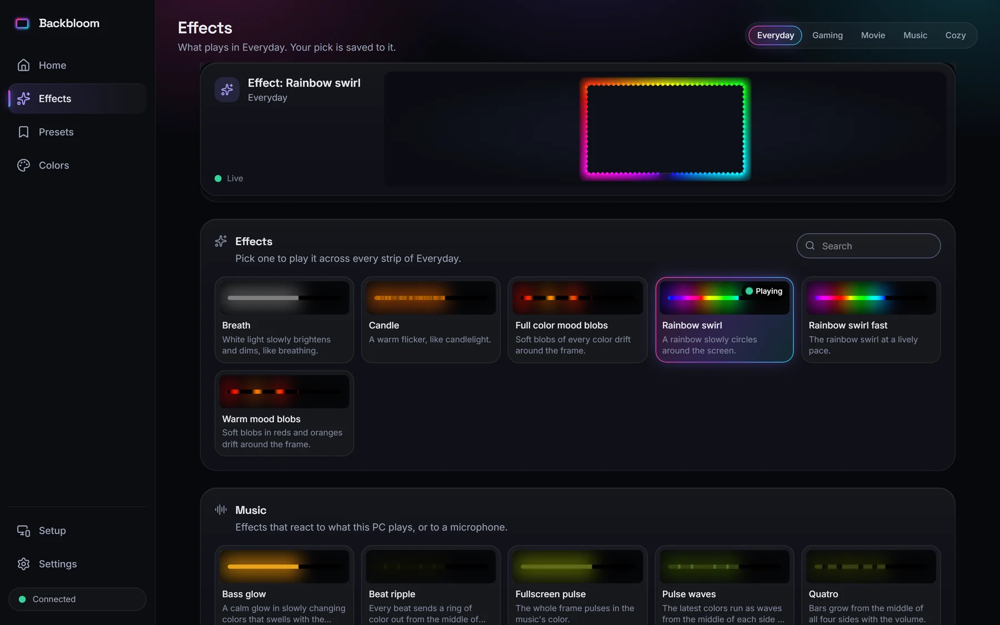

<p align="center">
  
</p>

<h1 align="center">Backbloom</h1>

<p align="center">
  <strong>Ambient lighting for Windows: your LEDs follow the screen and the music in real time.</strong>
</p>

<p align="center">
  <a href="https://github.com/valburkin/Backbloom/actions/workflows/ci.yml"></a>
  <a href="https://github.com/valburkin/Backbloom/actions/workflows/codeql.yml"></a>
  <a href="https://github.com/valburkin/Backbloom/releases/latest"></a>
  <a href="LICENSE"></a>
  
</p>

<p align="center">
  
  
  
  
  
  
</p>

<p align="center">
  <a href="https://github.com/valburkin/Backbloom/releases/latest"><strong>Download for Windows</strong></a>
  &nbsp;·&nbsp; <a href="#features">Features</a>
  &nbsp;·&nbsp; <a href="#supported-devices">Devices</a>
  &nbsp;·&nbsp; <a href="#for-developers">Developers</a>
  &nbsp;·&nbsp; <a href="docs/roadmap.md">Roadmap</a>
  &nbsp;·&nbsp; <a href="https://getbackbloom.com">Website</a>
</p>

Backbloom captures your screen (HDR included) or the sound that's playing, maps the picture onto the LED strips around
your monitor or TV and the lights in your room, and drives them in real time. It sets up new LED strips by itself,
finds smart lights on your network, and runs quietly in the tray.



## Get started

1. **Download** `BackbloomApp-stable-Setup.exe` from the [latest release](https://github.com/valburkin/Backbloom/releases/latest)
   and run it. It installs for your user only (no administrator rights needed) and starts Backbloom.
   Windows may show "Windows protected your PC" because the installer isn't code-signed yet: choose **More info**,
   then **Run anyway**.
2. **Add your lights.** The first-run setup searches for them: a WLED board over USB, on its own Wi-Fi or on your
   network, and room lights such as Philips Hue, Nanoleaf or Govee. New LED strips are set up step by step, with
   checks for the strip type, the colors and the power supply. If you used HyperHDR before, its settings are imported.
3. **Turn the lights on.** Pick a preset (Everyday, Gaming, Movie, Music, Cozy) and a Look, and you're done. Backbloom
   lives in the tray next to the clock; it updates itself when a new release comes out.

**What you need:** Windows 10 (1809 or later) or 11, and something to light: usually an LED strip behind the screen
with a small Wi-Fi LED controller running [WLED](https://kno.wled.ge/), or smart lights you already own. The
[hardware testing guide](docs/testing-guide.md) lists common setups and their power needs.

## Features

- **Screen sync**: GPU-accelerated desktop capture with HDR tone mapping (PQ and scRGB, 3D LUT), black border
  detection and multi-monitor support, at up to 60 frames per second.
- **Music**: nine music effects (spectrum, VU meter, beat ripple, waterfall, bass glow and more) driven by what the PC
  plays or by a microphone, with no setup.
- **Effects**: rainbow swirls, mood blobs, breath, candle and more, previewed on your own layout.
- **Room layout**: place each strip where it really is, on a drawing of your room around the screen. Any part of a
  strip can follow the screen edge next to it, the whole picture, an effect, music or a color, or stay off.
- **Presets and Looks**: saved setups for gaming, movies, music or a cozy evening, switched by hand or automatically
  while a program runs (your game's preset turns on when it starts). A Look sets the transitions, saturation and
  brightness in one click.
- **Guided hardware setup**: puts a new WLED board on your Wi-Fi, finds which connection each strip is on, and keeps
  the brightness within what the power supply can deliver.
- **Color**: per-channel calibration, gamma, color temperature, saturation, minimal backlight and a power limit.
- **Smooth transitions**: a soft spring by default, five more styles for those who want them. See
  [docs/smoothing.md](docs/smoothing.md).
- **Desktop app**: tray menu, a window with the settings, optional start with Windows, sleep and lock handling,
  automatic updates.
- **Private by default**: the app listens on `127.0.0.1` only. Phones and other devices on your network can control
  it once you turn remote access on and choose a password; device searches run only when you ask.
- **Integrations**: JSON-RPC over WebSocket and HTTP (compatible with HyperHDR clients for the commands the UI uses),
  MQTT with Home Assistant discovery.

<p align="center">
  
  
</p>

## Supported devices

| Group | Devices |
|---|---|
| Network | WLED, DDP, E1.31 (sACN), Art-Net, Philips Hue (REST and Entertainment), Nanoleaf, LIFX, WiZ, Yeelight, Govee (LAN), Home Assistant, Zigbee2MQTT |
| USB serial | Adalight-compatible controllers (Ada, AWA with HyperSerial, LightBerry APA102), Skydimo, SP616E |
| USB HID | Robobloq SyncLight |

Discovery (mDNS, SSDP, UDP broadcast, serial and HID enumeration) finds most of them without typing an address. Tried
Backbloom with a device? A [hardware report](https://github.com/valburkin/Backbloom/issues/new/choose) helps others
know it works.

## For developers

Backbloom is a C# / .NET 10 desktop app with a React + TypeScript web UI that it serves itself. The backend is a
layered set of small projects (Core, Capture, Audio, Devices, Discovery, Engine, Server, Shell, App, plus
`*.Windows` platform projects) with strict dependency rules, an allocation-free per-frame path guarded by tests, and
golden fixtures that pin behavior ported from HyperHDR's C++ code. [docs/architecture.md](docs/architecture.md) shows
the layers and the frame pipeline as diagrams.

### Requirements

- Windows 10 1809 or later (the desktop features are Windows-only; the portable projects build anywhere .NET runs)
- [.NET SDK 10.0.402](https://dotnet.microsoft.com/download/dotnet/10.0) or a later 10.0 feature band (pinned by
  [backend/global.json](backend/global.json))
- [Node.js 24](https://nodejs.org/) with npm

### Build, test, run

```powershell
# web UI
cd ui
npm ci
npx tsc --noEmit
npm test
npm run build            # -> ui/dist, copied next to the app by the backend build

# backend
cd ../backend
dotnet build -warnaserror
dotnet test
dotnet run --project src/Backbloom.App -c Release -- --capture synthetic --data-dir .local/dev --legacy-data-dir none

# installer (UI build, self-contained publish, Velopack package) -> artifacts/releases
cd ..
./packaging/build.ps1
```

A build run from the source tree keeps its settings in `backend/.local/data` (the command above uses `.local/dev`
instead), drives the LEDs with a synthetic test pattern when started with `--capture synthetic`, writes to a null LED
device until you add a real one, and listens on `127.0.0.1:18290` only. `backbloom --help` lists every option. The UI
also runs on its own against a built-in mock (`npm run dev`, then open `http://localhost:5173/?mock`). More in
[docs/development.md](docs/development.md).

### Repository layout

| Path | |
|---|---|
| [backend/](backend) | .NET 10 solution: `src/` (Core, Capture, Audio, Devices, Discovery, Mqtt, Settings, Engine, Server, Shell, Platform.Windows, App) and `tests/` (xUnit v3, golden fixtures). Overview in [backend/README.md](backend/README.md). |
| [ui/](ui) | React 19 + TypeScript + Vite + Tailwind CSS web UI, served by the app; Vitest tests. |
| [packaging/](packaging) | Windows installer and automatic updates (Velopack), third-party notice generator. |
| [docs/](docs) | Architecture, protocol, settings, smoothing, development guide, hardware testing guide, roadmap; the backend reference in [docs/backend/](docs/backend). |
| [branding/](branding) | Logo, app icon and installer images. |
| [site/](site) | The landing page (static, Vite). |

### Documentation

| Topic | Document |
|---|---|
| Testing with your own lights | [Hardware testing guide](docs/testing-guide.md) |
| How Backbloom is built | [Architecture](docs/architecture.md): projects, dependency rules, the frame pipeline, threading |
| Every subsystem in detail | [Backend reference](backend/README.md#subsystem-reference) |
| Talking to the app | [JSON-RPC protocol](docs/protocol.md) |
| Settings and data | [Settings and HyperHDR import](docs/settings.md) |
| Transitions | [Smoothing](docs/smoothing.md): the default spring and the styles compared |
| Setting up hardware | [Guided hardware setup](docs/guided-setup.md) |
| Working on the UI | [UI guidelines](docs/ui-guidelines.md) |
| Working on the code | [Development guide](docs/development.md): tools, tests, coverage, branches and releases |
| Building the installer | [Packaging](packaging/README.md) |
| Where it is going | [Roadmap](docs/roadmap.md) and [Immersion](docs/immersion.md) |
| What changed | [Changelog](CHANGELOG.md) |

## Contributing

Bug reports, hardware reports, ideas and pull requests are welcome. Please read [CONTRIBUTING.md](CONTRIBUTING.md)
first, and the [Code of Conduct](CODE_OF_CONDUCT.md). Security issues: see [SECURITY.md](SECURITY.md).

Backbloom is built with AI coding assistants (Claude Code) under the author's direction; design decisions, review and
hardware testing are the author's. [CLAUDE.md](CLAUDE.md) holds the project notes those assistants follow.

## License and credits

Backbloom is released under the [MIT License](LICENSE).

It started as a fork of [HyperHDR](https://github.com/awawa-dev/HyperHDR) by awawa-dev (MIT), itself derived from
[Hyperion.ng](https://github.com/hyperion-project/hyperion.ng) (MIT), and is now a C# / .NET port with a new UI.
Golden fixtures exported from HyperHDR's C++ code keep the behavior identical where it should be. Thanks to awawa-dev,
the HyperHDR and Hyperion contributors, and the authors of the libraries in
[THIRD-PARTY-NOTICES.md](THIRD-PARTY-NOTICES.md). See [NOTICE.md](NOTICE.md) for details.

Product names and trademarks mentioned here belong to their owners and are used only to describe compatibility.
