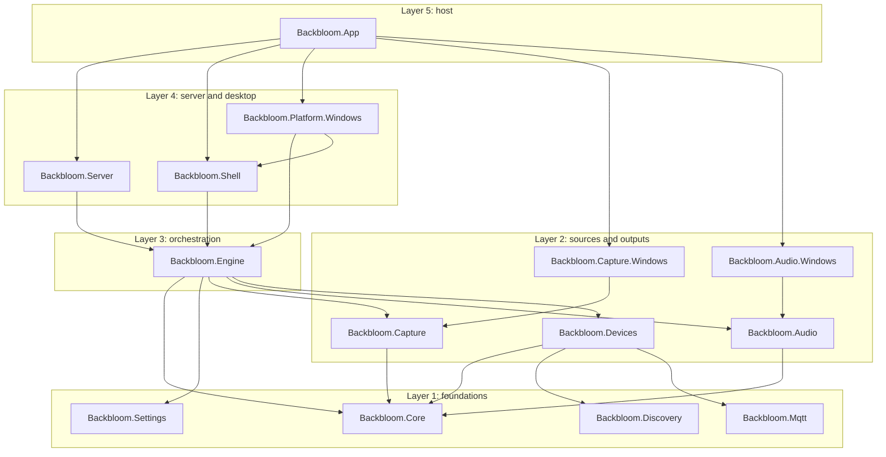
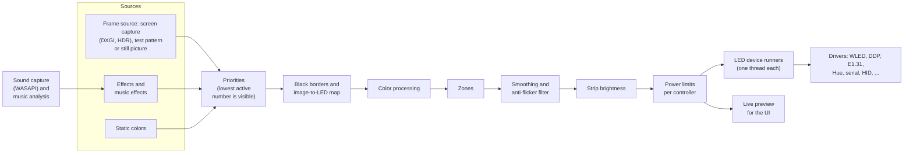

# Architecture

An overview of how Backbloom is built: the projects and their dependency rules, the path a frame takes from the screen
to the LEDs, the threads, and the rules that keep the per-frame path cheap. The [backend reference](../backend/README.md)
describes each subsystem in detail.

## Contents

- [One process](#one-process)
- [Projects and dependency rules](#projects-and-dependency-rules)
- [Frame pipeline](#frame-pipeline)
- [Presets, Looks and the lighting gate](#presets-looks-and-the-lighting-gate)
- [Threading](#threading)
- [Hot path](#hot-path)
- [Behavior references](#behavior-references)
- [Terminology](#terminology)

## One process

One process, `backbloom.exe`, does everything: screen and sound capture, color processing, smoothing, LED output, the
web server for the UI and the API, the tray and the window. The React UI in `ui/` is a static web app that the process
serves itself and shows in a WebView2 window; it talks to the backend over [JSON-RPC](protocol.md).

HyperHDR ran one complete pipeline per "instance"; Backbloom runs one pipeline that fans out to several LED
controllers.

## Projects and dependency rules

The backend is a set of small projects in five layers. A project may only reference projects of lower layers, and the
projects within layer 1 don't reference each other.

The arrows are the direct project references in `backend/src/*/*.csproj`; everything else is reached transitively.

| Layer | Projects | Contents |
|---|---|---|
| 1 | `Backbloom.Core`, `Backbloom.Settings`, `Backbloom.Discovery`, `Backbloom.Mqtt` | Pure logic (layout, mapping, color, smoothing, priorities, effects, music analysis); settings schemas, SQLite store, HyperHDR import; mDNS/SSDP and device enumeration; the MQTT connection. |
| 2 | `Backbloom.Capture`, `Backbloom.Audio`, `Backbloom.Devices`; `Backbloom.Capture.Windows`, `Backbloom.Audio.Windows` | Frame and sound source abstractions; LED drivers and their lifecycle, the guided setup's Improv and WLED clients; the Windows implementations of capture and sound (TerraFX interop). |
| 3 | `Backbloom.Engine` | Orchestration: frame loop, component switches, sources, controllers, effects, preview feed. |
| 4 | `Backbloom.Server`, `Backbloom.Shell`; `Backbloom.Platform.Windows` | Kestrel JSON-RPC, UI files and the MQTT integration; tray menu, window placement, power policy, single instance; the Windows tray, WebView2 window, autostart, power and session events, monitor sizes, and Wi-Fi (wlanapi) for the guided setup. |
| 5 | `Backbloom.App` | Composition root (the only place that creates services), command line, logging, installer hooks and updates. |

Platform code lives only in `*.Windows` projects, behind interfaces defined in the layers above them, so macOS and Linux
can get their own projects later. The [backend README](../backend/README.md#projects) lists what each project contains.

## Frame pipeline

Step by step:

1. **Sources.** A frame source (DXGI screen capture, a synthetic test pattern, or a still picture), an effect, or a
   static color. The sound capture feeds the music analysis that music effects read.
2. **Priorities.** The lowest active priority number is visible; 255 means nothing is visible, and the LEDs go off. The
   screen sits at 245, the background (idle) effect at 254, the startup effect at 0, and colors and effects from clients
   at 1 to 253. ([Sources and priorities](backend/engine.md#sources-and-priorities))
3. **Image-to-LED map** (pictures only). Black border detection, then each LED averages its area of the frame (sparse
   sampling, precomputed offsets). "Screen average" LEDs are slowed down by their own filter.
   ([LED controllers and the layout](backend/layout-and-controllers.md#data-model))
4. **Color processing.** Temperature, calibration, gamma, gains, minimal backlight, brightness and the power limit.
   Static colors skip the color settings except the brightness and the power limit.
5. **Zones.** Parts of strips that play their own effect or color are written into their LEDs.
   ([Zones](backend/layout-and-controllers.md#zones))
6. **Smoothing** (optional, on its own thread and at its own rate) and the **anti-flicker filter**.
   ([Smoothing](smoothing.md))
7. **Strip brightness**, then each controller's **power limits** times the brightness (`PowerBudget`).
   ([Power limits](backend/layout-and-controllers.md#power-limits))
8. **Output.** Every enabled controller gets its slice of the frame on its own device thread, and the UI's live preview
   gets the same frame.

The mapping, color pass and smoother run once for all controllers together, so N controllers cost the same as one
controller with that many LEDs.

## Presets, Looks and the lighting gate

- **Presets** are profiles stored in the layout. A profile gives strips other roles while it is on; it is chosen by hand
  (saved in the `presets` settings section) or by a running program (`ProfileMonitor`, polling `IProcessList`). Turning
  a profile on clears the colors and effects that clients started.
- **Looks.** A profile's Look puts its own transitions and color gains on top of the saved settings without changing
  them (`LookTuning`).
- **Capture rate.** The screen capture's rate follows the smoothing that applies: at least 60 fps while transitions are
  fast (`CaptureRateFollower`).
- **Lighting gate.** `LightingGate` (Engine) can hold the output: the controllers stay closed while the first-run setup
  isn't completed or while HyperHDR runs (`OtherAppMonitor` behind the `IProcessList` platform interface).
- **Network access is opt-in.** The server listens on loopback until `network.remoteAccess` is turned on, and discovery
  opens sockets only while a search runs. ([Access, first run and network](backend/access-and-first-run.md))

## Threading

| Thread | Does |
|---|---|
| Frame loop (above normal) | capture or step the visible effect, map, process, step the zones, hand the frame to the controllers and the preview |
| Smoothing (above normal) | one tick per update interval while smoothing runs; idle otherwise |
| One per controller | open with retries, send the newest frame, refresh, close |
| Sound capture | while a music effect runs: read WASAPI buffers, analyze blocks |
| Thread pool | JSON-RPC requests (in order per connection), event pushes, update checks, the process checks (HyperHDR, profile programs), the performance samples (with the GPU counters), the WLED status reads |
| UI thread (STA) | Win32 message loop: tray, WebView2 window, power and session notifications |
| Log writer | the rolling log file |

The frame loop never waits on a controller or a client: a controller that hasn't sent the previous frame drops the new
one. Settings changes build new immutable objects and swap them in with one reference write. Details:
[Threading and the hot path](backend/threading-and-performance.md).

## Hot path

The frame loop, the controller submit path and the sound capture loop don't allocate in steady state:

- buffers are sized when the LED count or frame size changes;
- lookup tables are precomputed;
- drivers send from preallocated packet buffers over connected sockets;
- logging uses `[LoggerMessage]` methods, never called per frame.

Allocation tests in Core, Devices, Engine, Capture, Capture.Windows and Audio enforce it. Measured with 168 LEDs at
60 fps: about 1.3 % of one core and a 62 MB working set.

## Behavior references

Behavior ported from HyperHDR is pinned by golden fixtures exported from its C++ code
([backend/tests/fixtures](../backend/tests/fixtures/README.md)); they are frozen now that the C++ code is gone. The
deliberate deviations from HyperHDR are listed in the fixtures README and on the backend pages where they apply.

## Terminology

The code and the UI use different words for some concepts; the UI's words are fixed in the
[UI guidelines](ui-guidelines.md#words).

| Code and protocol | UI | Meaning |
|---|---|---|
| controller | device | hardware that receives colors (a WLED board, a Hue bridge, a USB kit) |
| output | output | one LED connection of a controller |
| strip | strip | a physical LED strip, wired to one output |
| section | part | a piece of a strip between two of its points |
| profile | preset | saved roles for the strips, optionally with a Look and programs that turn it on |
| look | Look | transitions, saturation and color brightness, minimum glow |
| zone | (none) | the LEDs of all parts that play the same effect or color |
| smoothing | transitions | how gently colors change |
