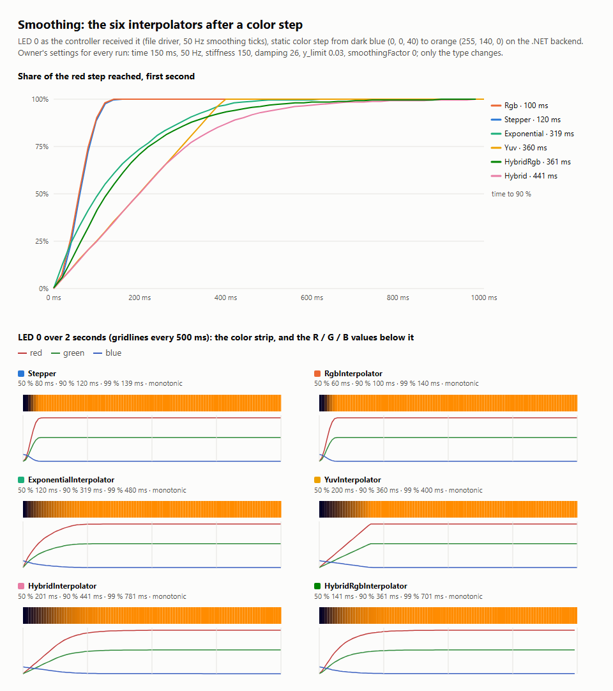

# Smoothing

Smoothing moves the LEDs towards each new frame's colors over time instead of jumping, so fast cuts and flickering
content look calm. It runs on its own thread at `updateFrequency` ticks per second (the rate the controllers then
receive) and stops sending once a transition has finished (three more frames, then one per second), unless
`continuousOutput` is on.

## The interpolators compared

Each run: LED 0 as the controller received it (file driver, 50 Hz ticks) after a static color step from dark blue
(0, 0, 40) to orange (255, 140, 0), with the same settings (time 150 ms, stiffness 150, damping 26, y_limit 0.03,
smoothingFactor 0); only the type changes.

| Type | Time to 90 % | Character |
|---|---|---|
| `Stepper` | 120 ms | covers the distance within about `time_ms`, small differences faster; the default |
| `RgbInterpolator` | 100 ms | Stepper plus `smoothingFactor` (blends each new target with the previous one) |
| `ExponentialInterpolator` | 319 ms | exponential approach with time constant `time_ms`, independent of the frame rate |
| `YuvInterpolator` | 360 ms | linear in Y'CbCr with the brightness change per tick limited by `y_limit`: no hue shift while fading |
| `HybridRgbInterpolator` | 361 ms | a damped spring per RGB channel (`stiffness`, `damping`): soft start and landing |
| `HybridInterpolator` | 441 ms | the spring in Y'CbCr with the `y_limit` brightness limit |

All six are monotonic for this step (no overshoot). The spring types start and land softly; Stepper and RGB react
fastest. The owner's setup uses HybridRgb.

## Settings (`smoothing`)

| Setting | |
|---|---|
| `enable` | initial state of the `SMOOTHING` component |
| `type` | one of the six above |
| `time_ms` | transition time (Stepper, RGB, YUV) or time constant (Exponential) |
| `updateFrequency` | ticks per second; interval `round(max(1000 / max(f, 20), 5))` ms |
| `smoothingFactor` | target blending (RGB, YUV, HybridRgb) |
| `stiffness`, `damping` | spring constants (Hybrid, HybridRgb) |
| `y_limit` | maximum brightness change per tick (YUV, Hybrid) |
| `continuousOutput` | keep sending at the full rate after a transition |
| `antiFlickeringFilter` | hold an LED until it changes by about half an 8-bit step |

Effects bring their own smoothing configuration (for example 200 ms at 25 Hz, or direct output for music effects).

## Difference from HyperHDR

HyperHDR's Hybrid and HybridRgb transitions never finished when a target channel was below the minimal backlight
(black, or the zero channels of a saturated color), so smoothing kept sending at the full rate forever. Backbloom
finishes them when such a channel rests at the backlight level; see
[backend/tests/fixtures/README.md](../backend/tests/fixtures/README.md).
